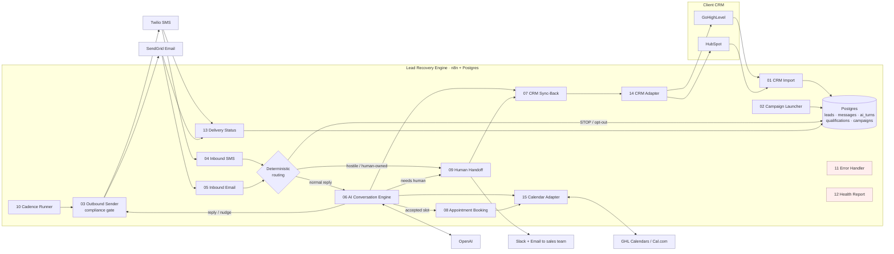

# 01 · Architecture

## The problem in one line
Investors have thousands of dormant seller leads in their CRM. Lead Recovery Engine (LRE) re-opens those conversations by SMS/email, has a natural AI-led qualification conversation, books qualified sellers onto the sales team's calendar, and writes everything back to the CRM, without breaking texting rules.

## System diagram



## Lead lifecycle

```
new ─► queued ─► contacted ─► engaged ─► qualifying ─► qualified ─► appointment_booked
                    │             │            │             └──► handed_off (human owns it)
                    │             └──► nurture (follow-up date) ──► back to engaged on reply
                    └──► not_interested · wrong_number · bad_number · dnc (terminal)
```
Status changes are logged to `events` by a DB trigger. Moving into dnc/booked/closed automatically stops cadences (DB trigger, so nothing can be forgotten).

## Key design decisions (and why)

| Decision | Why it makes the system reliable, scalable and cheap |
|---|---|
| **n8n (self-hosted, queue mode) + Postgres** rather than Make/Zapier | No per-operation pricing. A reactivation campaign does tens of thousands of operations per day, which gets expensive on Make. Queue mode with Redis and horizontally scalable workers. Workflows are visual, so a non-developer can follow them. You own everything. |
| **Our own Postgres is the conversation system of record; the CRM is the sales system of record** | CRM APIs are rate-limited, slow and differ per vendor. Keeping state locally makes every decision fast and consistent, makes switching CRMs a one-adapter job, and gives a full audit trail (every message, every AI decision, every CRM write). |
| **The model talks; code decides** | OpenAI returns *structured JSON* (strict schema): reply + extracted facts + proposed action. Deterministic, unit-tested code then merges facts, **scores** the lead, validates the action (can't book a slot we never offered), and applies **guardrails** (no prices, no "I'm human", no links, length limits). A bad completion leads to a human handoff and never to a wrong action. |
| **Deterministic opt-out before AI** | STOP/"remove me"/hostile messages are handled by rules, never by the model. Suppression is also enforced by a **database trigger**, so no bug or manual edit can re-text an opted-out number. |
| **One sender for everything** (workflow 03) | Quiet hours, state frequency caps, daily caps, opt-out checks, first-message disclosure, CAN-SPAM footer, logging and bad-number handling all sit in a single place. |
| **Adapters for CRM (14) and Calendar (15)** | Supporting a new CRM (Salesforce, Podio, REsimpli…) means adding one branch. Nothing else changes. |
| **Generated workflows** (`tools/build-workflows.js`) | Business logic lives in plain JS files with unit tests, and the build inlines it into n8n Code nodes. Prompts are versioned in git. Workflow IDs are stable, so re-deploys are safe. |
| **Debounce + row locking** | Leads often send 2–3 texts in a row. The AI waits ~20s and answers once. The cadence uses `FOR UPDATE SKIP LOCKED`, so multiple workers never double-send. |

## Reliability features
- Twilio signature verification on every webhook; SendGrid webhooks protected with a secret key.
- Idempotency: inbound messages are de-duplicated on provider message ID; reminders and hot-alerts are claimed once.
- Retries with backoff on all HTTP/DB nodes; error outputs route to safe fallbacks (AI failure → human handoff, calendar failure → apology + handoff).
- Central error workflow logs to `workflow_errors` and alerts Slack, de-duplicated by signature.
- Hourly heartbeat to healthchecks.io (dead-man switch) plus anomaly alerts (error spikes, delivery failure rate > 15%, unanswered inbound).
- Nightly backups of both databases.

## Scalability
| Load | Setup |
|---|---|
| 1–5 clients, ≤ 20k leads | 1 VPS (2 vCPU / 4 GB), 1 worker |
| 5–25 clients | 4 vCPU / 8 GB, `--scale n8n-worker=3`, managed Postgres |
| 25+ clients or white-label SaaS | One stack per client (isolation, per-client credentials), or move CRM credentials into the DB (see `docs/05-crm-integration.md` → Multi-tenant) |

The real throughput limit is SMS sending, not compute. Each campaign has a `daily_new_limit` and each client a `daily_send_cap`, which ramp volume gradually to protect number reputation and A2P throughput.

## Deployment model (v1)
**Recommended: one stack per client business.** It is the simplest and safest choice: credentials, phone numbers, data and failures are isolated, and handover per client is clean. The schema is already multi-tenant (`client_id` everywhere), so you can run several clients on one stack when they share CRM credentials (for example, an agency with GHL sub-accounts under one agency token).
